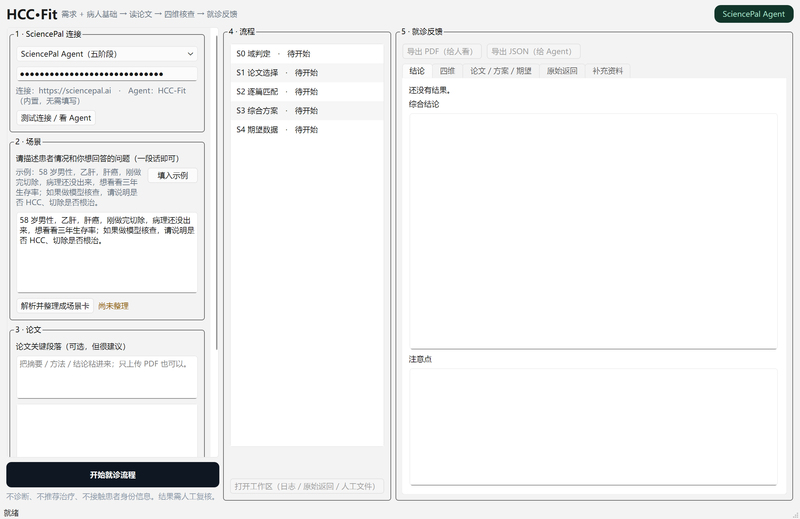

# HCC-Fit

**肝细胞癌（HCC）预测模型「场景适配核查」桌面工具。**
输入一段患者描述，自动整理成可审阅的场景卡，再让 SciencePal Agent 判断：某个已发表的 HCC 预测模型/列线图，是否适用于这位患者、这个时点、这个结局。

> 仅用于临床决策前的证据准备与模型适用性讨论：**不做诊断、不推荐治疗、不预测个体生存期数字**，结论需医生判读。
>
> **许可**：本仓库与随附的 Windows 打包版本按《HCC-Fit 测试评估许可》提供——**专有、保留所有权利**，
> 仅限内部评估测试，禁止商业使用与再分发。详见 [`LICENSE.md`](LICENSE.md)。

## 它解决什么问题

论文里的预测模型（如术后 1 年复发 nomogram）通常只在特定人群、特定时点、特定结局、特定输入下成立。
把它套到眼前这位患者之前，需要逐维核对：**人群 / 时点 / 输入 / 结局**。

HCC-Fit 把这套核对做成可追溯的流程：

1. **场景卡**：自由文本 → 规则抽取（疾病、治疗、阶段、术后时长、结局、起点、预测范围、意图），
   只对不足的字段集中追问；原话、整理值、状态、来源片段、确认状态全部落盘；
2. **候选检索（可选）**：内置 PubMed Router，fast（规则）/ balanced（Agent 逐篇筛 fit 0-2），
   标注可读性（PMC 免费全文 / 仅摘要 / 仅题录）；
3. **核查**：两种模式
   - `SciencePal HCC-Fit 多篇论文综合`：S0 域判定 → S1 选论文 → S2 逐篇四维匹配 → S3 综合方案 → S4 期望补充数据；
   - `SciencePal HCC-Fit 单篇论文核查`：一条提示词直接产出核查报告（缺 JSON 时自动二次修复）；
4. **反馈**：结论（「匹配」绿色、「不匹配」红色）、四维表（含证据强度）、逐维理由与原文引文、
   方案与期望数据、原始返回；**历次报告**可随时切回（第 1 次、第 2 次……）；
5. **补充资料**：报告给出缺什么之后，可补文字或 PDF；**默认沿用原会话追问**（不新开），
   让 Agent 记得上一轮的分析；
6. **导出**：PDF（给人看）与 `visit.json`（给 Agent/审计）。



## 快速开始

### 方式一：直接用打包版（Windows 10/11 64 位，无需 Python）

从 Releases 下载 `HCC-Fit_*_win64.zip`，解压后双击 `启动 HCC-Fit.bat`。
未做代码签名，首次运行 Windows SmartScreen 会提示，选「更多信息 → 仍要运行」。

> 需要 SciencePal API Key（[sciencepal.ai](https://sciencepal.ai) → 用户中心 → 连接与开发 → API 与 Python SDK）。
> Key 只存在内存里：不写注册表、不写日志、不写 `visit.json`。

### 方式二：从源码运行

```bash
cd desktop
pip install PySide6 requests
python main.py
```

打包（one-dir）：

```bash
cd desktop
pip install pyinstaller
python -m PyInstaller --noconfirm HCC-Fit.spec
```

## 目录

```
desktop/            桌面应用（PySide6）
  app/              主窗口、场景卡、Router 对话框、补充资料、导出
  core/             planner / sciencepal brain / hcc_report / 纯标准库 pdftext
  resources/        terms.csv（规则词表）、schemas（visit / input_session / supplement）
  tests/            12 个回归脚本
router/             内置 PubMed 检索核心（hccfit）
tools/              manifest、截图、真 Key 验证脚本
docs/               接入说明、口述例子检验
HANDOFF.md          历史流水账（按时间追加）
HANDOFF_2026-10-31.md  当前状态与交接说明（入手先读这个）
```

## 环境变量

| 变量 | 作用 | 默认 |
|---|---|---|
| `SCIENCEPAL_API_KEY` | Key（通常直接在界面填） | 空 |
| `SCIENCEPAL_BASE_URL` | 站点 | `https://sciencepal.ai` |
| `SCIENCEPAL_AGENT_ID` | 桌面大脑 Agent | 内置 `HCC-Fit` |
| `SCIENCEPAL_FILTER_AGENT_ID` | balanced 筛选 Agent | 内置 `HCC-Fit` |
| `SCIENCEPAL_MODEL` | 指定模型 | 空（平台默认） |
| `HCCFIT_DATA_DIR` | 数据目录覆盖 | `%LOCALAPPDATA%\HCC-Fit\HCC-Fit Desktop` |

## 测试

```bash
cd desktop
set PYTHONIOENCODING=utf-8
set QT_QPA_PLATFORM=offscreen
python tests/test_input_normalization.py
python tests/test_clinical_examples.py
python tests/test_supplement.py
python tests/test_modes.py
python tests/smoke.py          # 期望 SMOKE OK

cd ../router
python -m unittest discover -s tests
```

提交前：`python tools/regen_manifest.py`（会打印 `verify: OK`）。

## 数据与隐私

- 患者描述、工作区、日志只写本地 `%LOCALAPPDATA%\HCC-Fit\HCC-Fit Desktop\`，仓库里没有任何真实患者数据；
- 发送给 SciencePal 的内容 = 你填的场景 + 选中的论文/附件，请自行确认合规；
- `.env`、`_secrets/`、工作区、输入会话均已 gitignore。

## 免责声明

本工具用于**方法学层面的模型适用性核查**，输出不构成诊断、治疗建议或个体化风险预测，
不能替代多学科讨论与主治医师判断。使用者需自行核对论文原文与最新指南。

## 相关文档

- 交接与现状：[`HANDOFF_2026-10-31.md`](HANDOFF_2026-10-31.md)
- SciencePal 接入与检索说明：[`docs/HCC-Fit_SciencePal接入与检索说明_2026-10-30.md`](docs/HCC-Fit_SciencePal接入与检索说明_2026-10-30.md)
- 桌面端细节：[`desktop/README.md`](desktop/README.md)
- 许可条款：[`LICENSE.md`](LICENSE.md)

## 许可

本仓库代码、文档与随附的 Windows 打包版本均按 **HCC-Fit 测试评估许可（Proprietary Evaluation License）**
提供：Copyright (c) 2026 WANG Ziye. All rights reserved.

- 允许：内部评估、试用、运行、为评估阅读源码、反馈问题；
- 禁止：商业使用、对外提供服务、再分发（含转发 zip/网盘/镜像）、作为医疗器械或用于诊断决策；
- 期限：自获取起 90 天，或作者书面终止；终止后停止使用并删除副本；
- 需商业使用 / 机构部署 / 再分发：请先取得作者书面许可。

完整条款见 [`LICENSE.md`](LICENSE.md)。
