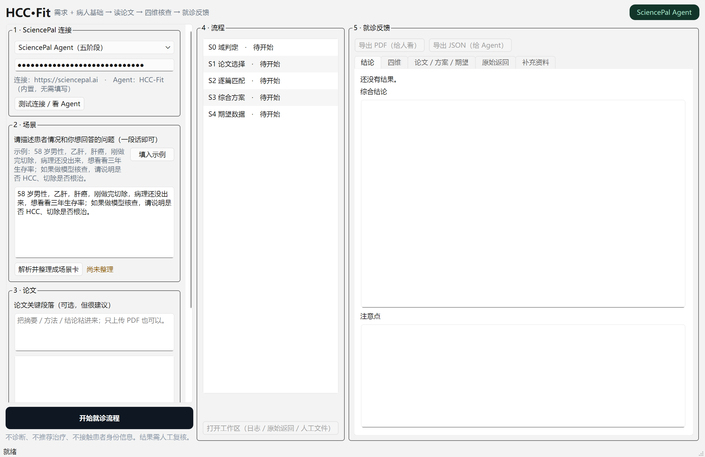
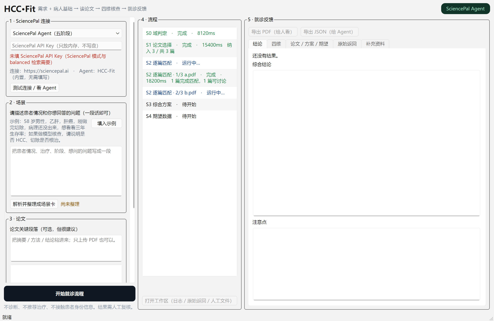
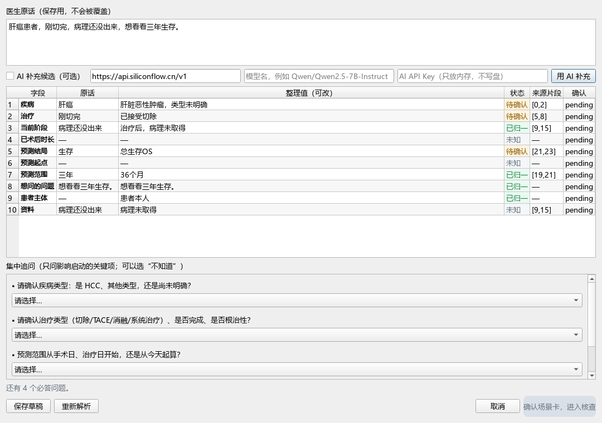
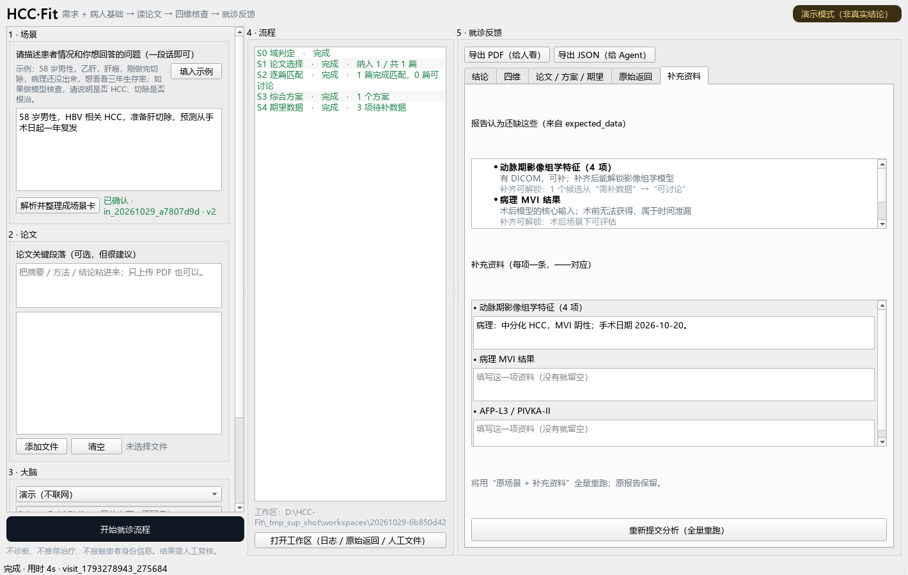
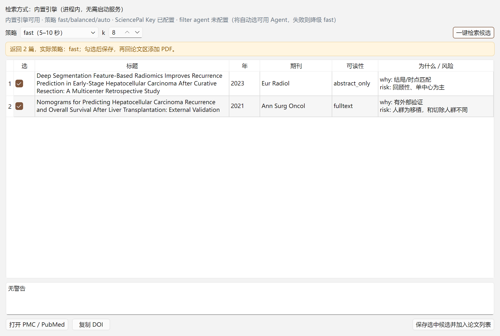

# HCC-Fit 桌面版（PySide6）

> P0–P4 + 输入层 P1 已完成：单输入场景卡、三栏窗口、2 种大脑模式、内置 Router（一键检索）、真实 SciencePal 单次核查、四维/证据/原始返回、PDF/JSON 导出、人工工作区入口、Windows one-dir。
> Web 版（`HCCFIT_APP`）保留作对照；桌面版复用它的 core，不再起 HTTP 服务。

## 运行

**已构建好的 exe（推荐，不用 Python）**：双击 `desktop_build/HCC-Fit/HCC-Fit.exe`，
或双击包根目录的 `启动 HCC-Fit.bat`。整个 `HCC-Fit` 文件夹一起复制/移动，exe 不能单独拿走。

从源码运行：

```bash
pip install PySide6 requests
python main.py
```

或双击 `run_desktop.bat`。



## 当前功能（P0–P4 + 输入层）

- 场景：**一个自由输入框**（一段话）+ 解析后的可编辑场景卡；追问、确认后才进入核查；
- 论文：拖拽或选择文件、粘贴关键段落、**内置 PubMed 候选检索**（无需启动服务）；
- 多篇：可勾选 **“多篇时逐篇发给 Agent（较慢）”**（五阶段逐篇 S2；单次核查逐篇出报告后合并；较慢但更聚焦）；
- 连接：2 种模式（SciencePal Agent 五阶段 / HCC-Fit 单次报告）、只填 Key（Base/Agent 内置）、测试连接；
  “演示 / 本地模拟 / 人工中转”已于 2026-10-30 按要求从界面移除；
- 流程：五阶段或 HCC 单次核查的实时状态；逐篇模式下**每篇单独一行**（“2/3 文件名 · 运行中/完成 · tier/耗时”）；
- 结果：结论、四维表（含证据强度）、逐维理由与引文、论文/方案/期望、原始返回；
- 二次 JSON 修复：首次返回 Markdown 时自动追问 JSON，成功后绿色提示，原始 Markdown 保留；
- 运行计时、当前阶段、失败原因；“打开工作区”可看 `run.log` / `sp_raw/`；
- 原始返回：**默认隐藏**（右上角“显示原始返回”可展开）；Agent 降级或二次 JSON 修复时自动显示；
  内容始终保存在 `visit.json` 的 `raw_answers`（给 Agent/审计），PDF 不包含原文；
- 导出：PDF（给人看，一页/两页 A4）与 JSON（`visit.json`，给 Agent）。



## 输入归一（P1 已完成；2026-10-30 补齐 P0 三项）

- 场景只有一个输入框：医生写一段话，不要求标准词；
- 解析后弹“场景卡”：字段 / 原话 / 整理值 / 状态 / 来源片段 / 确认 / **信息是否足够**，可直接改；
- 集中追问（疾病类型、治疗、起点、结局、**预测范围**等），允许“不知道”；**原话已有的信息不再追问**（见下）；
- 未确认、有冲突、超出 HCC 范围时，“进入核查”禁用；
- 修改后重新确认，`input_session.version + 1`；
- `肝癌、肝脏肿瘤、恶性肿瘤` 不会被自动归为 HCC；
- 每字段保存原话、整理值、状态、来源片段、确认状态、`concept_id`；
- 口述习惯兼容（2026-10-30 按 5 个临床例子补齐）：
  - 术后时长支持 **年/月/周/天**（“术后 2 年”“根治性切除一个月”“一个月复查”都识别）；
  - “刚开完刀 / 根治性手术 / 根治性切除”算作切除 + 术后；
  - 从**已有资料**里额外抠出：肿瘤大小（`10 公分`）、血管侵犯/癌栓（含“镜下癌栓”）、BCLC 分期（`巴塞罗那分期 B 期`）、分期范围（`0 到 A 期`）；
  - 意图按“疑问句 + 时间/结局词”打分（状态陈述如“复查都挺好”降权），同时问复发与生存时**两句都保留**；
  - “总的生存期/总生存率”视为明确 OS，不再追问结局；
  - “请说明是否 HCC / 是否根治”这类**待确认表述**不会被当成诊断（疾病仍标待确认）；
- **不再有 AI 候选层**（2026-10-30 按用户要求移除 `app/ai_extract.py` 及界面入口）；
- Agent v0.6 不修改，确认后的场景卡映射为原 `scenario`；
- 输入会话存 `AppLocalData/inputs/<input_id>.json`，原话不覆盖。

### 追问抑制（sufficient）

只有“信息不足”的字段才生成追问；判定写死在 `field_sufficient()`，可在场景卡“信息”列看到每字段是否足够：

| 字段 | 算“足够”的条件 |
|---|---|
| 疾病 | 明确 HCC（“肝癌/肝脏肿瘤/恶性肿瘤”不算） |
| 治疗 | 明确切除 / TACE / 消融 / 系统治疗 / 肝移植；“刚切完”只确认大类，不问术式 |
| 结局 | 明确 OS 或复发（RFS）；只说“生存/预后”仍要问 |
| 起点 | 明确手术日 / 治疗日 / 今天 |
| 预测范围 | 明确 1/3/5 年（`一年`、`3 年`、`36 个月`）；否则追问“1 年 / 3 年 / 5 年 / 自定义 / 不知道” |
| 问题 | 原话已经写清楚想问什么 |

### 空格软切分

医生常不写标点，只用空格断句。`split_sentences()` 现在 **硬标点 + 空格软切分**，并保护这些短语不被拆开：

- 数字 + 单位：`3 年`、`58 岁`、`1.5 cm`、`30 %`；
- 否定 + 内容：`非 HCC`、`无 腹水`、`未见 复发`；
- 拉丁复合名：`Child-Pugh A`、`hepatocellular carcinoma`、`BCLC B`、`ECOG 0`；
- 多个空格 / 全角空格 / 制表符视为明确分隔，照切。

因此 `58 岁男性 刚切完 想看看三年生存` 与 `HCC 准备肝切除 从手术日 想看看 3 年 OS` 都能正确解析（后者 `3 年` → 36 个月）。



命令行演示 / 测试：

```bash
python tools/input_demo.py "肝癌患者，刚切完，病理还没出来，想看看三年生存。"
python tests/test_input_normalization.py   # 15/15
python tests/test_clinical_examples.py     # 5/5：用户给的 5 个口述例子
python tests/test_input_review.py          # 场景卡 UI 冒烟（含零追问场景）
```

## 报告后补充资料

报告给出 `expected_data` 后，结果页有“补充资料”页签：

- 上方用**一个只读文本框**显示报告认为还缺的资料，自动换行、不横向滚动；
- 下方**每一条缺失资料对应一个输入框**，填这一项的资料；
- “重新提交分析”：用**原场景 + 补充原文**全量重跑，不改 Agent v0.6；
- 原报告保留，完成后顶部可切换“本次报告 / 上一次报告”；
- 补充记录存 `AppLocalData/supplements/<supplement_id>.json`；
- 补充只追加资料，不自动改诊断；改变疾病/治疗/时点请回场景卡确认；
- 补充原文会按“资料名：内容”拼成一段，再交给下一次全量重跑。

测试：

```bash
python tests/test_supplement.py      # 拼接/落盘/空输入
python tests/test_supplement_ui.py   # stub → 补充 → 重跑 → 新旧切换
```



## PubMed 候选（Router 已内置，一键检索）

论文区的 **“找候选论文（内置 PubMed）”** 直接用桌面进程内的 Router 引擎
（`app/router_engine.py` 调用 `hccfit.strategies.run`）：

- **不需要单独启动服务、不占 8080、不需要 uvicorn**；打包时 `router/hccfit` 已随 exe 一起带走；
- 对话框只显示**内置引擎**状态（是否可用、策略、Key / filter agent 是否配置）；不再有“检索方式”切换；
- 选 `fast`（5–10 秒）或 `balanced`（60–90 秒），选 k（1–8），点 **“一键检索候选”**；
- **只需要填 SciencePal Key 一处**：左侧最上方 **“1 · SciencePal 连接”**；
  Base（`https://sciencepal.ai`）与 Agent（`HCC-Fit`，ID `61033129-…-280a`）**已内置**，不用填；
  空/非 ASCII/含空格会实时红字警告，`start_run` 与 balanced 检索也会拦住并提示；
  如需换站/换 Agent：环境变量 `SCIENCEPAL_BASE_URL` / `SCIENCEPAL_AGENT_ID`（设空则回退按名称查找/自动路由）；
- **filter agent 也已内置**（同一个 `HCC-Fit` Agent）；环境变量 `SCIENCEPAL_FILTER_AGENT_ID` 优先，
  显式设为空则退回“自动选择可用 Agent/降级 fast”；界面不再询问。
- 可读性（中文）：**免费全文（PMC）** / **仅摘要（全文可能收费）** / **仅题录（无摘要）**；
  勾选 **“只看 PMC 免费全文”** 会过滤掉仅摘要候选（会多取一些再筛，返回可能少于 k）；
- 打开/复制：**选中哪篇就开哪篇**；多选（Ctrl/Shift 或勾选）会同时打开多个网页 / 复制多条链接；
  “复制 DOI”同理（多选每行一个）；没选行时按勾选处理，未勾选才退回第一篇；
- 打开链接顺序：**ShellExecute（os.startfile）→ 验证浏览器窗口出现 → 直接启动默认浏览器
  （等 1.2s 看退出码）→ explorer → Qt → webbrowser**；失败时弹窗给出**失败原因**（如 exit=21）
  并复制链接，不再假报“已请求”
  ShellExecute / Qt / webbrowser；候选表底部还有 **“复制链接”**，浏览器没弹出来时可手动粘贴；
- 勾选候选后保存为 `router_candidates_*.md` 并加入论文列表；
- **这只是题录/摘要，不是全文**；S2 四维核查仍需 PDF 或正文；
- 该步骤是**可选前置**，不替换 S1，五阶段 Agent 逻辑不变。

接入细节（官方 Agent 规则、fast vs balanced 的提示词差异、五阶段、错误码）见
[`docs/HCC-Fit_SciencePal接入与检索说明_2026-10-30.md`](../docs/HCC-Fit_SciencePal接入与检索说明_2026-10-30.md)。

**外部 HTTP 服务**（`router/` + `RouterClient` + `/v1/search`）作为核心代码保留，供多端/远程部署与命令行使用，
但**界面不再提供入口**；需要时用 `RouterClient`/`curl` 直连，或双击包根目录 `启动 Router 服务.bat`。
服务端默认不鉴权（`HCCFIT_ROUTER_TOKEN` 留空），仅远程部署时用环境变量配置。

开发态内置引擎默认找包内同级 `router/`；也可用 `HCCFIT_ROUTER_DIR` 指向别处。



测试：

```bash
python tests/test_router_engine.py   # 内置引擎 + 候选对话框（打开链接/标题换行/保存）10 项
python tests/test_paths.py           # 数据目录可写性/回退 2 项
python tests/test_router_client.py   # Router 场景映射
```

## 数据与密钥

- 工作区：`QStandardPaths.AppLocalDataLocation/workspaces/<sid>`；
- 输入会话：`QStandardPaths.AppLocalDataLocation/inputs/<input_id>.json`；
- 补充记录：`QStandardPaths.AppLocalDataLocation/supplements/<supplement_id>.json`；
- 可用环境变量 `HCCFIT_DATA_DIR` 覆盖（测试用）；未设置时会在 `AppData` 候选目录里挑**真正可写**的，
  不可写（如受限进程的 `LocalLow`）会自动回退到临时目录，避免 `PermissionError`。
- Key 只放输入框内存，不写 QSettings、不写日志、不写 `visit.json`；
- QSettings 只保存模式/场景/Base/Agent。

## 测试

```bash
python tests/smoke.py                    # 主窗口：确认场景卡 → stub → 导出 JSON/PDF → schema
python tests/test_input_normalization.py # 规则/冲突/追问抑制/空格切分/schema 15 项
python tests/test_clinical_examples.py   # 5 个临床口述例子（术后时长/癌栓/BCLC/意图）
python tests/test_input_review.py        # 场景卡对话框（含“零追问”场景）
python tests/test_supplement.py          # 补充资料拼接/落盘
python tests/test_supplement_ui.py       # 补充重跑 + 新旧报告切换
python tests/test_router_client.py       # Router 场景映射
python tests/test_router_engine.py       # 内置 Router 引擎（状态/透传/错误/对话框）
python tests/test_modes.py               # 大脑只剩 2 种；已移除模式明确报错
```

## 目录

```
hccfit_desktop/
├── main.py
├── app/
│   ├── paths.py       工作区、文件复制、数据目录
│   ├── runner.py      mode → brain/planner（不碰 HTTP）
│   ├── workers.py     RunWorker / ProbeWorker（QThread）
│   ├── export.py      PDF（QTextDocument+QPdfWriter）/ JSON
│   ├── input_normalization.py  单输入规则层（分句/术语/状态/追问抑制）
│   ├── input_review.py         场景卡对话框
│   ├── input_store.py          输入会话落盘
│   ├── router_engine.py        内置 Router（进程内调用 hccfit.strategies.run）
│   ├── router_client.py        场景映射 / HTTP 客户端 / 后台 Worker
│   ├── router_dialog.py        候选论文对话框（内置/HTTP 两种检索方式）
│   └── main_window.py          主窗口
├── core/              从 Web 版复制的业务模块（planner/sciencepal/contract/hcc_report…）
├── resources/terms.csv          术语/同义词表
├── resources/schemas/           visit + input_session schema
└── tools/input_demo.py          CLI 演示
```

## Windows 打包（P4 已完成）

```bash
pip install pyinstaller
python -m PyInstaller --noconfirm HCC-Fit.spec
```

产物：`dist/HCC-Fit/HCC-Fit.exe`（one-dir，约 119MB，含内置 Router；整个 `HCC-Fit` 文件夹一起分发）。

自检（不显示窗口：确认场景卡 → stub → 导出 PDF → 场景卡对话框 → 内置 Router 可用性）：

```bat
set QT_QPA_PLATFORM=offscreen
HCC-Fit.exe --smoke
echo %ERRORLEVEL%   :: 0 = OK（失败原因写到 AppLocalData\smoke.json）
```

只测内置 Router（会联网访问 PubMed，fast，取 3 篇）：

```bat
HCC-Fit.exe --router-smoke
echo %ERRORLEVEL%   :: 0 = 检索成功；2 = 引擎不可用；3 = 检索失败
```

已验证：打包后的 exe 在 Windows 下 `--smoke` 退出码 0、`--router-smoke` 成功返回 3 篇候选。

> 打包会把 `router/hccfit` 与 toolkit 冻进 exe，`desktop/` 和 `router/` 必须是同级目录再执行 PyInstaller。

## 后续

- 代码签名/安装包（可选）；
- macOS/Linux 字体与打包（Windows 验收后再做）。
